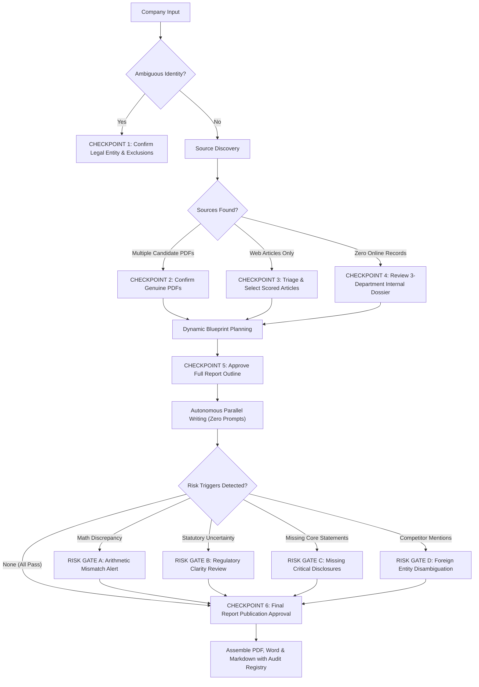

# Generic Autonomous Annual Report Generation Agent
*Universal Enterprise-Grade Autonomous Annual Report Architect*

An autonomous agent that synthesizes publication-grade annual reports for **any company, industry, country, or jurisdiction** (listed, unlisted private, or maiden/first-year startups) from verified corporate records and regulatory evidence. **Nothing about the report structure is hardcoded.**

---

## 1. Core Architecture & Upgrade Highlights

1. **Mandatory ChromaDB + SQLite Persistence (`storage.py`)**:
   - Zero in-memory BM25 index and no raw `kb.json` dependencies.
   - **SQLite**: Persists structured documents, chunk text, page numbers, metadata, and full evidence logs.
   - **ChromaDB**: Handles vector embeddings and semantic similarity queries with metadata filtering (`doc_id`, `page`, `is_table`).
2. **Universal Intelligence & Zero-Template Principle (`skills.py`, `planner.py`)**:
   - Synthesizes dynamic structures tailored to the company's real business model, operating segments, and home corporate law (e.g. US SEC 10-K, India Companies Act 2013 / SEBI, UK Strategic Report, European CSRD/IFRS).
3. **Cold-Start & Zero-Online-Presence Entities (`knowledge.py`)**:
   - **Peer Benchmarking (`--peer-report`)**: Ingests established peer reports strictly for structural chapter taxonomy without copying peer financials.
   - **Three-Department Intake (`--first-year`, `--dossier`)**: Ingests primary corporate records from:
     1. Executive / CEO Office (Genesis, vision, milestones).
     2. Finance & Accounts (Trial balance, capital structure, Schedule III statements).
     3. Legal & Secretarial (CIN, Section 173 Board meetings, Section 139 auditor, Section 135 CSR).
4. **Deterministic Financial Verification (`financial.py`)**:
   - Audits tables for mathematical accuracy: checks row-sum totals ($A + B = \text{Total}$), uniform currency/scale ($₹\text{ Cr}$, $\$M$, $€M$), and balances.
5. **5-Tier Audit Statuses (`schemas.py`, `validator.py`)**:
   - Classifies draft sections into `PASS`, `WARNING`, `REVIEW_REQUIRED`, `FAIL`, or `NOT_VERIFIABLE`.
6. **Multi-Format Document Parsing (`knowledge.py`)**:
   - Scanned PDF support with automatic OCR fallback.
   - Native Word document (.docx) parsing with heading and table preservation.
7. **Report Assembly & Auditability Appendix (`assembler.py`)**:
   - Generates publication-ready `.pdf` (ReportLab multiBuild with page-numbered TOC), `.docx` (Word TOC field), and `.md` with an automated **Auditability Register & Evidence Mapping** appendix.

---

## 2. Risk-Based Human Approval Approach (Zero Trivial Prompts)

The system does **NOT** interrupt users for trivial writing tasks. It uses an intelligent, risk-based tiered approach:



### The 8 Specific Risk Triggers Implemented:
1. **Ambiguous Company Identity**: Confirms trade name vs. legal parent, ticker, and excluded competitors.
2. **Unverified / Conflicting Sources**: Human selects verified documents when automated search yields ambiguous candidates.
3. **Missing Material Financial Information**: Alerts user if Balance Sheet or P&L has no public source data before publishing with disclaimers.
4. **Conflicting Financial Figures**: Triggered when independent verification detects arithmetic mismatches ($A + B \neq \text{Total}$).
5. **Uncertain Regulatory Applicability**: Triggered when statutory regime or accounting standard cannot be determined online.
6. **Material Extraction Failures**: Alerts user if scanned PDFs fail OCR text extraction.
7. **Significant Validation Failures**: Triggers review if drafts fail math verification or contain forbidden competitor names.
8. **Final Report Approval**: High-level summary sign-off before generating final publication PDFs.

*All human decisions are stored in `runs/<company>_<fy>/approvals.json` for seamless `--resume`.*

---

## 3. Setup & Execution

### Setup (Windows PowerShell)
```powershell
pip install -r requirements.txt
```

### Run Commands

```powershell
# Standard Run (Listed or Unlisted Entity in Any Country)
python main.py "Infosys" --fy "FY 2024-25" --country India

# Cold-Start / First-Year Entity (Zero Online Presence)
python main.py "Inaugural Tech Solutions Pvt Ltd" --fy "FY 2024-25" --country India --first-year

# Using a Peer Report to Benchmark Industry Structure
python main.py "Inaugural Tech Solutions Pvt Ltd" --fy "FY 2024-25" --first-year --peer-report "peer_report.pdf"

# User-Supplied PDF or DOCX Reference Report
python main.py "Enterprise Corp" --fy 2024 --country USA --pdf "path/to/annual_report.pdf"

# Headless / Automated Execution (Accepts Agent Proposals)
python main.py "Company Name" --fy "FY 2024-25" --auto-approve

# Resume or Retry Failed Sections
python main.py "Company Name" --fy "FY 2024-25" --resume
```

### Run Evaluation Test Suite
```powershell
python -m unittest test_suite.py
```
Outputs are saved in `runs/<company>_<fy>/`:
- `<report_id>.pdf`: Publication-grade PDF with cover, styled tables, and TOC.
- `<report_id>.docx`: Editable Microsoft Word document with native TOC field.
- `<report_id>.md`: Full Markdown source.
- `blueprint.json`: Complete structural plan.
- `run_report.json`: Execution audit summary.
